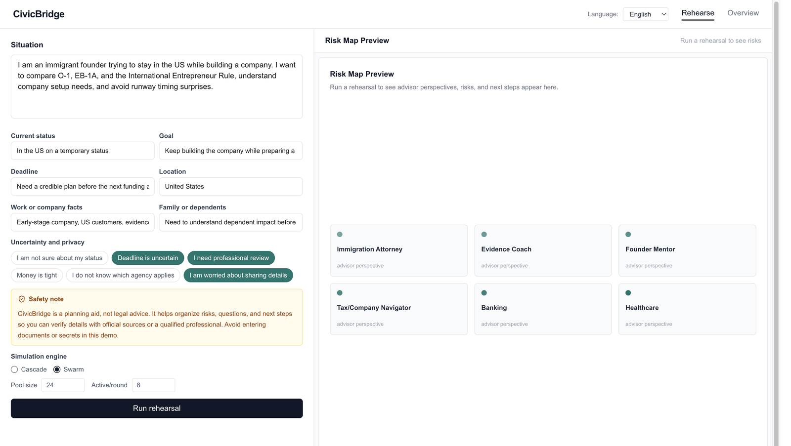

# CivicBridge

Rehearse an immigration or settlement decision before you act.

CivicBridge is a planning aid for immigrant founders and newcomers. You describe a situation, a panel of simulated advisors walks the dependencies, and you get an action report: known facts, open uncertainties, items to verify, and questions for a qualified professional. Eligibility, approval odds, and government timelines stay with the agencies and with licensed professionals.



## Contents

- [Problem](#problem)
- [Approach](#approach)
- [Results](#results)
- [Quick start](#quick-start)
- [Demo](#demo)
- [Stack](#stack)
- [Layout](#layout)

## Problem

A founder comparing O-1, EB-1A, and the International Entrepreneur Rule is also juggling company setup, evidence, runway, dependents, and tax. A newcomer in the first stretch of life in the United States is sequencing an identifier, a bank account, health coverage, housing, and taxes. Those systems do not share a calendar. The collisions — a filing window against runway, a missing document against a deadline, a dependent against a lease — show up only when the threads are read together.

A single dataset, or a single chat answer, either overclaims an outcome or stays too vague to plan from. CivicBridge is the rehearsal in between: it makes the cross-system tensions visible while the facts are still marked uncertain.

## Approach

The app keeps a multi-agent rehearsal engine and points it at two advisor panels.

1. **Intake.** The rehearsal screen opens with a situation, key facts (status, goal, deadline, location, work or company, family), and uncertainty chips. Unknowns do not block the run. A safety note stays on screen, and the demo asks you not to paste documents or secrets.
2. **Advisors.** A founder run uses Immigration Attorney, Evidence Coach, Founder Mentor, and Tax / Company Navigator. A first-1000-days run (`track: "first1000"`) uses Banking Navigator, Healthcare Navigator, Housing Navigator, Tax Navigator, and Local Systems Mentor. Personas carry role-specific biases and are forbidden from guaranteeing outcomes.
3. **Rehearsal.** Cascade runs the full panel round by round. Swarm keeps a larger pool and lets a subset speak each round. Events stream to the browser over a WebSocket. TypeDB, Neo4j, NATS, and Temporal are optional; if they are down, the API still finishes the run.
4. **Action report.** When the run completes, `GET /simulate/{id}` returns the transcript plus a report: executive summary, risks, recommended actions, grounded facts, open uncertainties, facts to verify, questions for a professional, official source links, and a planning-aid caveat.

The rehearsal screen sends the founder track. The first-1000-days panel is selected by sending `track: "first1000"` to `POST /simulate`.

## Results

Shipped v1.0 (audited 2026-05-09) plus a local founder cascade run on 2026-10-26. That run used the on-screen demo and the rule-based fallback, with no cloud model.

| Check | Result |
| --- | --- |
| v1 requirements | 23 / 23 satisfied |
| Phases verified | 6 / 6 |
| Critical paths | Intake → live simulation → report; backend stub → report; WebSocket history → report |
| Example founder cascade | Completed. 60 advisor messages across 15 rounds. Report hydrated on GET |
| Report contents | Known facts, open uncertainties, verify-before-acting items, professional questions, source links, caveat |
| Simulation tests | 16 passed |
| Stub report test | 1 passed (`Backend/tests/test_stub_snapshot.py`) |
| Languages in the UI | English, Spanish, French, Italian, Chinese, Japanese, Russian |

| Track | Advisors | What the rehearsal is for |
| --- | --- | --- |
| Founder | Immigration Attorney, Evidence Coach, Founder Mentor, Tax / Company Navigator | Compare a pathway, evidence, company setup, and timing without treating the output as an eligibility decision |
| First 1000 days | Banking, Healthcare, Housing, Tax, Local Systems | Sequence identifiers, money, coverage, housing, and taxes, and flag what still needs a professional or an official page |

## Quick start

Python 3.11+ and Node.js 20+. Docker is optional.

```bash
python3.11 -m venv .venv
source .venv/bin/activate
pip install -r requirements.txt
```

Three terminals, from the repo root, with the virtualenv active:

```bash
cd Backend && uvicorn api.main:app --reload --port 8000
```

```bash
cd Simulation && uvicorn app:app --reload --port 8001
```

```bash
cd Frontend && npm install && npm run dev
```

Open [http://localhost:3000/simulate](http://localhost:3000/simulate). The founder situation is already filled in. Press **Run rehearsal**. When the risk map marks complete, open the action report.

The API listens on port 8000. If the frontend runs elsewhere, set `NEXT_PUBLIC_API_URL` in `Frontend/.env.local` and restart `npm run dev`.

Without a reachable model, persona text and round decisions use the built-in rules, so the demo still finishes. To use a cloud model, put `OPENAI_API_KEY` in `Simulation/.env` (that file is gitignored).

```bash
pytest Simulation/tests -v
pytest Backend/tests/test_stub_snapshot.py -v
cd Frontend && npm run lint && npm run build
```

## Demo

The screenshot above is the rehearsal screen: situation, key facts, uncertainty chips, the safety note, and the advisor preview. The founder copy compares O-1, EB-1A, and the International Entrepreneur Rule against company setup and runway timing.

After you run it, the report keeps three buckets separate:

- facts you provided
- facts you marked uncertain
- facts that still have to be checked against a primary source or a licensed professional

## Stack

| Layer | Role |
| --- | --- |
| Next.js 16 (App Router) | Rehearsal, overview, and report UI. `next-intl` for seven locales |
| FastAPI (`Backend`, port 8000) | `POST /simulate`, `GET /simulate/{id}`, WebSocket stream |
| Simulation service (port 8001) | Personas, cascade or swarm rounds, risk extraction, report |
| Optional | TypeDB, Neo4j, NATS JetStream, Temporal. The demo runs when they are absent |

## Layout

```
Backend/        API, demo seed, schema, loaders
Simulation/     rehearsal service, advisor templates, tests
Frontend/       Next.js app
infra/          config.yaml (advisor tracks) and optional mock data
docs/           README screenshot
```

Advisor tracks live in [`infra/config.yaml`](infra/config.yaml). Persona templates live in `Simulation/templates/`.
