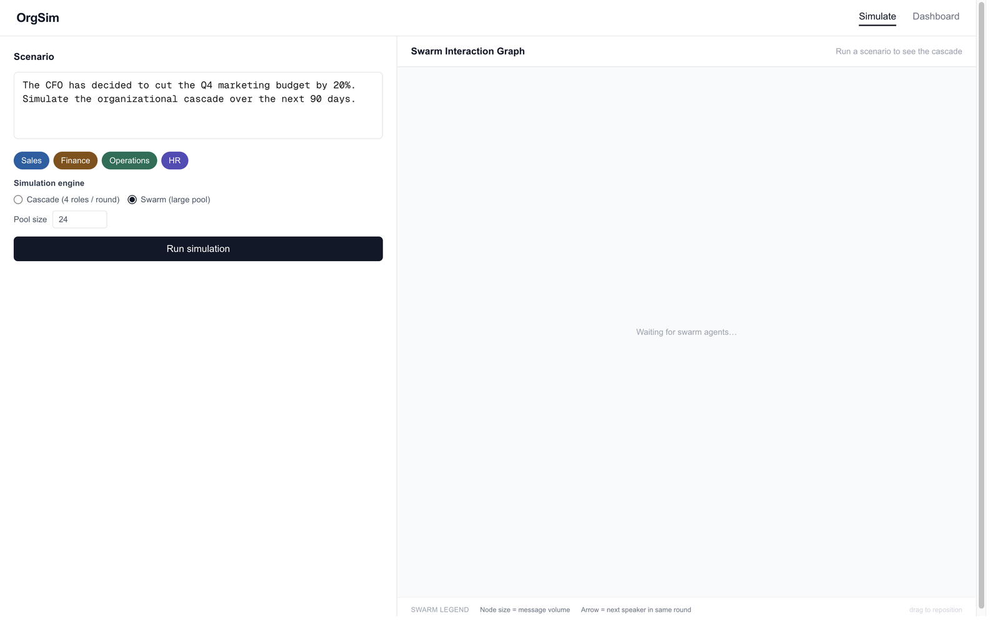

# OrgSim — Organizational Decision Rehearsal

OrgSim won the IBM agent orchestration hackathon. It rehearses a C-suite decision before anyone makes it. A panel of department agents — CFO, VP of Sales, Operations Lead, HR Director — argues from its own numbers, and the system forecasts the conflicts that exist only in the interaction between those departments.

The loop is a proposed decision plus a set of departments. Personas are loaded from YAML, each with a KPI, a risk tolerance, and actions it will and will not take. Cascade lets the full panel speak every round. Swarm keeps a larger pool and activates a subset per round. After the rounds, a conflict extractor pairs opposing positions from different departments and writes an executive report.

The demo is already on the simulate screen:

> The CFO has decided to cut the Q4 marketing budget by 20%. Simulate the organizational cascade over the next 90 days.

Departments selected: Sales, Finance, Operations, HR.



## Table of Contents

- [Overview](#overview)
- [How a run works](#how-a-run-works)
- [Architecture](#architecture)
- [Features](#features)
- [Directory structure](#directory-structure)
- [Requirements](#requirements)
- [Installation](#installation)
  - [1. Clone](#1-clone)
  - [2. Python](#2-python)
  - [3. Frontend](#3-frontend)
  - [4. Optional services](#4-optional-services)
- [Model setup](#model-setup)
- [Run the demo](#run-the-demo)
- [API](#api)
- [Stakeholder templates](#stakeholder-templates)
- [Configuration](#configuration)
- [Troubleshooting](#troubleshooting)

## Overview

Existing enterprise tools automate a workflow that already exists. OrgSim runs a decision that has not been made and shows where Sales, Finance, Operations, and HR will collide.

| Piece | What it does |
| --- | --- |
| Decision | Free-text scenario. The UI opens on the Q4 marketing cut. |
| Departments | Sales, Finance, Operations, HR, plus Engineering and Marketing. |
| Personas | One YAML file per role. Finance maps to the CFO, Sales and Marketing to VP Sales, Operations and Engineering to the Ops Lead, HR to the HR Director. |
| Cascade | All selected roles speak every round. |
| Swarm | Pool of agents. A subset speaks each round. UI default: pool 24, 8 active. |
| Conflicts | Opposing messages from two departments in the same round, tagged resource, priority, timeline, or budget, with a severity. |
| Report | Executive summary, conflicts, recommended actions, and the facts the scenario stated. |

The rehearsal finishes without a cloud key. If OpenAI and Ollama are both unreachable, persona text and round actions fall back to the rules in the templates.

## How a run works

1. The browser sends the decision and the selected departments to `POST /simulate`.
2. The API on port 8000 opens a run and probes `http://127.0.0.1:8001/health`.
3. The Simulation service builds personas from `infra/config.yaml` and `Simulation/templates/`.
4. The chosen engine runs the rounds and streams `agent_message` events over a WebSocket.
5. The conflict extractor emits cross-department conflicts.
6. `GET /simulate/{run_id}` returns the transcript, the conflicts, and the report. Refreshing the report page still works.

Start all three, from the repo root, with the virtualenv active:

```bash
cd Backend && uvicorn api.main:app --reload --port 8000
```

```bash
cd Simulation && uvicorn app:app --reload --port 8001
```

```bash
cd Frontend && npm run dev
```

Open [http://localhost:3000/simulate](http://localhost:3000/simulate) and press **Run simulation**.

The same scenario from the shell, against an API that is already up:

```bash
curl -s -X POST http://127.0.0.1:8000/simulate \
  -H 'content-type: application/json' \
  -d '{
    "decision": "The CFO has decided to cut the Q4 marketing budget by 20%. Simulate the organizational cascade over the next 90 days.",
    "departments": ["Sales", "Finance", "Operations", "HR"],
    "engine": "cascade",
    "rounds": 4
  }'
```

Or `cd Backend && python -m demo.seed_demo`.

## Architecture

```
Decision + departments
        │
        ▼
FastAPI :8000  ──WebSocket──►  Next.js /simulate
        │
        │  NDJSON
        ▼
Simulation :8001
  personas → cascade | swarm → conflict extractor → report
```

TypeDB, Neo4j, NATS JetStream, and Temporal are in `docker-compose.yml`. The demo does not require them. The API logs a warning and keeps going when a connection is refused.

| Path | Role |
| --- | --- |
| `Frontend/app/[locale]/simulate/page.tsx` | Scenario, department chips, live trace, graph |
| `Backend/api/routes/simulate.py` | Create a run, fetch a run |
| `Backend/api/ws/simulation.py` | Stream events to the browser |
| `Backend/api/simulation_snapshot.py` | Attach messages, conflicts, and the report to GET |
| `Simulation/app.py` | Persona, stream, conflict, and report routes |
| `Simulation/orgsim_engine/decision_cascade.py` | Full-panel rounds |
| `Simulation/orgsim_engine/swarm_cascade.py` | Subset-of-pool rounds |
| `Simulation/conflict/extractor.py` | Cross-department conflicts |
| `Simulation/org_persona_generator.py` | Persona text, including the rule fallback |
| `infra/config.yaml` | Department name → template id, swarm sizes |

## Features

- Role-specific bias. The CFO optimizes runway and prefers a budget cut. VP Sales protects pipeline coverage. Operations protects capacity. HR protects retention under quota pressure.
- Forbidden actions on each template. The CFO cannot add headcount or approve unbudgeted spend.
- Cascade and swarm, selectable on the simulate screen.
- Live activity trace and a swarm or conflict graph.
- Department snapshot at `/dashboard`.
- Executive report at `/report/{run_id}`.
- Scripted stakeholder stream for demos with no Simulation service: set `ORGSIM_ALLOW_MOCK_WEBSOCKET=1` on the API.

## Directory structure

```
org-simulator/
├── README.md
├── requirements.txt
├── docker-compose.yml          # TypeDB, Neo4j, NATS, Temporal, Ollama
├── infra/
│   ├── config.yaml             # department → persona
│   └── mock/                   # sales_pipeline.csv, finance_pl.json, ops_capacity.yaml, hr_people.json
├── Backend/
│   ├── api/                    # FastAPI, port 8000
│   ├── demo/seed_demo.py       # CFO scenario
│   ├── loaders/                # TypeDB loaders
│   └── schema/
├── Simulation/
│   ├── app.py                  # port 8001
│   ├── templates/              # cfo, vp_sales, ops_lead, hr_director
│   ├── orgsim_engine/
│   ├── conflict/
│   └── tests/
├── Frontend/                   # Next.js simulate, dashboard, report
└── docs/orgsim-simulate.png
```

## Requirements

- Python 3.11 or 3.12
- Node.js 20+
- An OpenAI or Ollama model only if you want generated lines instead of the template rules
- Docker only if you want TypeDB, Neo4j, NATS, Temporal, or containerized Ollama

## Installation

### 1. Clone

```bash
git clone https://github.com/Sebastianrodaaa/org-simulator
cd org-simulator
```

### 2. Python

```bash
python3.11 -m venv .venv
source .venv/bin/activate
pip install -r requirements.txt
```

Use this environment for `uvicorn` and `pytest`.

### 3. Frontend

```bash
cd Frontend
npm install
```

### 4. Optional services

```bash
docker compose up -d
```

TypeDB loaders, from `Backend`: `python -m loaders.run_all`. The CFO demo runs without that step.

## Model setup

Persona generation and each round share one rule.

| Mode | When | Env |
| --- | --- | --- |
| OpenAI | `OPENAI_API_KEY` starts with `sk-`, or `ORGSIM_USE_CLOUD_OPENAI=1` | `Simulation/.env`: `OPENAI_API_KEY` and `LLM_MODEL_NAME=gpt-4o-mini` |
| Ollama | Cloud mode is off | `OLLAMA_HOST` defaults to `http://127.0.0.1:11434`. `LLM_MODEL_NAME` defaults to `qwen2.5:14b` |
| Rules | That endpoint errors or is missing | Nothing to set. The demo still completes |

`Simulation/.env` is gitignored.

```bash
# Simulation/.env
OPENAI_API_KEY=sk-...
LLM_MODEL_NAME=gpt-4o-mini
ORGSIM_USE_CLOUD_OPENAI=1
```

## Run the demo

```bash
curl -s http://127.0.0.1:8000/health
curl -s http://127.0.0.1:8001/health
```

| URL | Screen |
| --- | --- |
| http://localhost:3000/simulate | Decision, departments, live trace, graph |
| http://localhost:3000/dashboard | Sales, Finance, Operations, HR |
| http://localhost:3000/report/`<run_id>` | Executive report |

```bash
pytest Simulation/tests -v
pytest Backend/tests/test_stub_snapshot.py -v
cd Frontend && npm run lint && npm run build
```

## API

`POST /simulate` returns 202. Body fields:

| Field | Description |
| --- | --- |
| `decision` | Required. The proposed decision. |
| `departments` | One or more of Sales, Finance, Operations, HR, Engineering, Marketing. |
| `engine` | `cascade` or `swarm`. Default `swarm`. |
| `rounds` | 1–40. The UI sends 4 for swarm and 15 for cascade. Swarm is capped at 15 in the streaming pipeline. |
| `swarm_size` | Pool size. Default 24. Range 4–512. |
| `max_active_per_round` | Speakers per swarm round. Default 8. Range 2–128. |

`GET /simulate/{run_id}` adds `messages`, `conflicts`, `report`, and `recommendation` once the run snapshot is attached.

`confidence_score` on the report is a rehearsal score, not a probability that the decision is correct.

Simulation service, port 8001:

| Route | Role |
| --- | --- |
| `GET /health` | Liveness. The API uses this to choose a live run or the stub. |
| `POST /generate-personas` | Build personas for the decision and departments. |
| `POST /stream-simulation` | NDJSON event stream for one run. |
| `POST /run-simulation` | Blocking run. |
| `POST /extract-conflicts` | Conflicts over a message list. |
| `POST /generate-report` | Report compilation. |

## Stakeholder templates

`simulation.department_templates` in `infra/config.yaml` maps an API department name to a file in `Simulation/templates/`. Point `ORGSIM_CONFIG` at another YAML file to replace it. Restart the Simulation service after an edit.

Each template has:

| Field | Effect |
| --- | --- |
| `role_title`, `department`, `agent_id` | Name on the transcript and the graph |
| `data_scope.read` / `data_scope.deny` | What that role can see |
| `action_scope.permitted` / `forbidden` | What that role will and will not do |
| `behavioral_bias` | `primary_kpi`, `risk_tolerance`, pushback triggers, alignment triggers, `preferred_action` |

Finance example, from `Simulation/templates/cfo.yaml`: primary KPI `runway_months`, preferred action `propose_budget_cut`, forbidden `propose_headcount_add` and `approve_unbudgeted_spend`.

## Configuration

| Variable | Where | Effect |
| --- | --- | --- |
| `NEXT_PUBLIC_API_URL` | `Frontend/.env.local` | API origin. Default `http://localhost:8000`. Restart Next after changing it. |
| `SIMULATION_SERVICE_URL` | API process | Simulation base URL. Unset: probe `http://127.0.0.1:8001`. |
| `ORGSIM_CONFIG` | Simulation process | Config path. Default `infra/config.yaml`. |
| `ORGSIM_ALLOW_MOCK_WEBSOCKET` | API process | `1`, `true`, or `yes` plays the scripted CFO / VP Sales / Ops / HR stream when no live queue is attached. Off by default. |
| `OPENAI_API_KEY`, `ORGSIM_USE_CLOUD_OPENAI`, `LLM_MODEL_NAME`, `OLLAMA_HOST` | Simulation process | Model selection. See [Model setup](#model-setup). |
| `TYPEDB_HOST`, `TYPEDB_PORT` | API process | Health check. Default `localhost:1729`. |
| `NEO4J_URI`, `NEO4J_USER`, `NEO4J_PASSWORD` | API process | Health check. Credentials are set in `docker-compose.yml`. |
| `NATS_URL` | API and Simulation | Default `nats://localhost:4222`. Publish is skipped when NATS is down. |

Swarm defaults in `infra/config.yaml`: engine `swarm`, pool 24, 8 active per round.

Runs live in process memory (`Backend/api/run_store.py`). Restarting the API drops them.

## Troubleshooting

**The button says it failed to start.** The UI cannot reach the API. `curl http://127.0.0.1:8000/health` should return 200. If the API is on another port, set `NEXT_PUBLIC_API_URL` and restart `npm run dev`.

**The graph stays empty.** The Simulation service was not up when the run was created. Start port 8001 and run again. `GET /simulate/{id}` can still return the stub report.

**Logs say the seed report is missing.** The persona generator continues with a stub seed. Load department data with `cd Backend && python -m loaders.run_all` when TypeDB is up.

**Ollama returns model 404, or DSPy says the endpoint is unavailable.** `LLM_MODEL_NAME` does not match a loaded model. Pull that model, or leave the endpoint down and use the rule fallback.

**`uvicorn` or `pytest` exits 126.** The virtualenv was created in another directory and the script shebangs are stale. Recreate it in this clone: `python3.11 -m venv .venv`. Or call `python -m uvicorn` and `python -m pytest` with that interpreter.

**Port already in use.** API 8000, Simulation 8001, Next 3000. Pass `--port` to uvicorn, or `npm run dev -- --port 3001`. CORS on the API allows localhost on any port. Set `NEXT_PUBLIC_API_URL` when the API is not on 8000.
